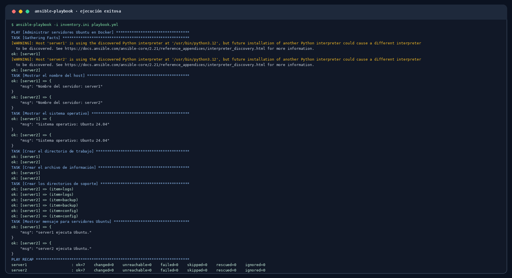

# Laboratorio de Ansible con Docker

## Objetivo

Crear dos servidores Ubuntu 24.04 en contenedores Docker y administrarlos con Ansible. El playbook muestra el nombre y el sistema operativo de cada servidor, crea `/tmp/ansible-demo/info.txt`, genera los directorios `logs`, `backup` y `config`, y muestra un mensaje solo en hosts Ubuntu.

## Requisitos

- Docker Engine y Docker Compose.
- Python 3 en la máquina desde la que se ejecuta Ansible.
- Ansible y la colección `community.docker`.

Desde esta carpeta, prepara un entorno virtual e instala Ansible y la colección requerida:

```bash
python3 -m venv .venv
source .venv/bin/activate
python -m pip install --upgrade pip
python -m pip install ansible docker
ansible-galaxy collection install community.docker
```

## Iniciar los contenedores

```bash
docker compose up -d
docker ps
```

Instala Python 3 dentro de cada contenedor para que Ansible pueda recopilar los facts y ejecutar los módulos:

```bash
docker exec -it server1 bash
apt update
apt install -y python3
exit

docker exec -it server2 bash
apt update
apt install -y python3
exit
```

## Comprobar conexión y ejecutar el playbook

```bash
ansible docker -i inventory.ini -m ping
ansible-playbook -i inventory.ini playbook.yml
```

La ejecución correcta debe terminar con `failed=0` para ambos servidores.

## Evidencia

Captura de una ejecución exitosa del playbook:


